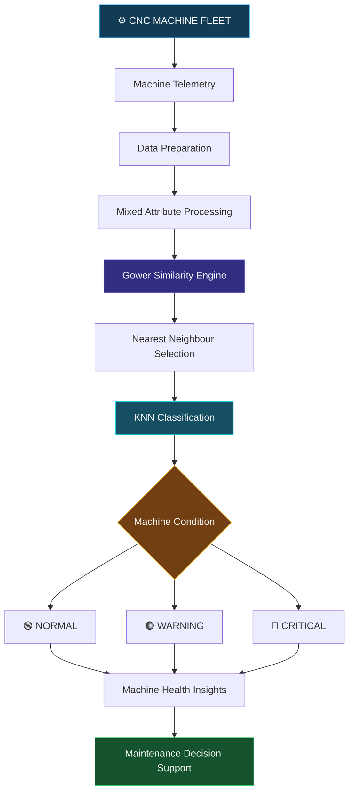
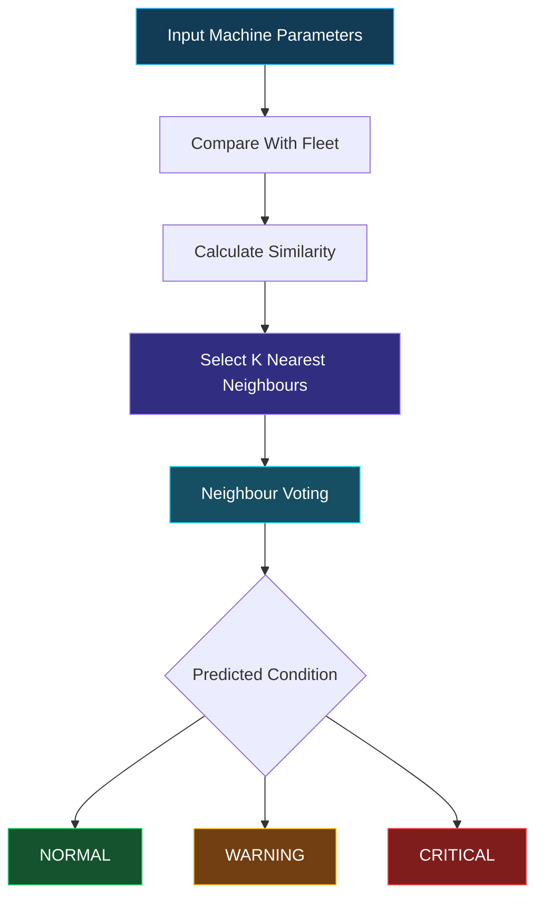
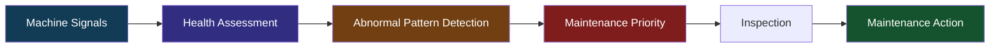
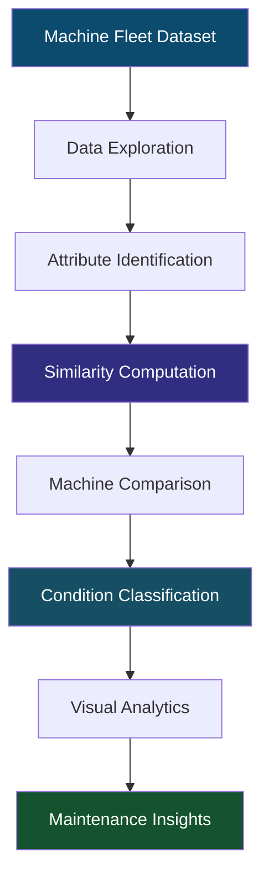
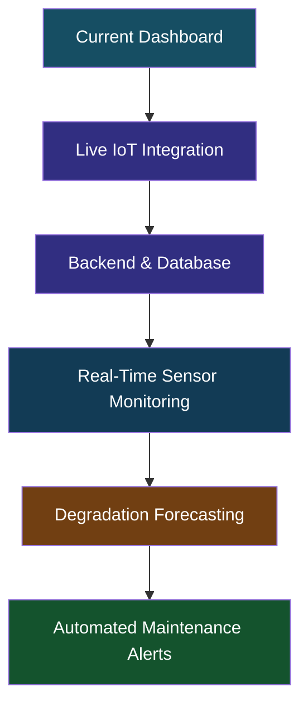

<div align="center">

# ⚙️ CNC AERO-HEALTH MONITOR

### `INTELLIGENT MACHINE HEALTH & PREDICTIVE MAINTENANCE`


**MONITOR. ANALYSE. PREDICT. PREVENT.**

A smart industrial analytics interface designed to transform machine telemetry into actionable health intelligence.

[🚀 EXPLORE PROJECT](https://vaishnvikedar6-jpg.github.io/CNC/)

</div>

---

# ◈ 01 — SYSTEM OVERVIEW

<div align="center">

| <sub>01 / MONITORING</sub> | <sub>02 / INTELLIGENCE</sub> | <sub>03 / PREDICTION</sub> |
|:---:|:---:|:---:|
| 🖥️ | 🧬 | 🧠 |
| **Machine Fleet** | **Gower Engine** | **KNN Classifier** |
| Telemetry Analysis | Similarity Intelligence | Condition Prediction |

</div>

CNC Aero-Health Monitor is a predictive maintenance dashboard that explores CNC machine operating parameters, identifies similar machine profiles and supports machine-condition assessment.

It brings together:

- Machine telemetry exploration
- Mixed-attribute similarity analysis
- K-Nearest Neighbors classification
- Machine health assessment
- Predictive maintenance insights
- Remaining Useful Life (RUL) related information

> The objective is to move from reactive maintenance towards intelligent, data-driven machine monitoring.

---

# ◈ 02 — THE DIGITAL CONTROL ROOM

### A unified machine intelligence environment

| CONTROL MODULE | FUNCTION |
|---|---|
| ◉ Fleet Intelligence | Machine fleet overview and health information |
| ◉ Machine Explorer | Individual machine parameters and records |
| ◉ Similarity Lab | Gower similarity matrix and machine comparison |
| ◉ Predictive Engine | KNN-based condition classification |
| ◉ Maintenance Centre | Engineering insights and maintenance support |

---

# ◈ 03 — SYSTEM ARCHITECTURE



---

# ◈ 04 — THE GOWER SIMILARITY ENGINE

### Understanding machines beyond numerical distance

Traditional distance metrics are not always suitable for datasets containing different attribute types.

Gower Similarity provides a way to compare mixed data:

- Numerical attributes
- Categorical attributes
- Binary attributes
- Ordinal attributes

### Mathematical Foundation

\[
S(i,j)=
\frac{\sum_k w_{ijk}s_{ijk}}
{\sum_k w_{ijk}}
\]

Where:

| Symbol | Meaning |
|---|---|
| \(S(i,j)\) | Overall similarity between machines |
| \(s_{ijk}\) | Similarity for attribute k |
| \(w_{ijk}\) | Attribute availability weight |
| \(k\) | Individual machine attribute |

<details>
<summary><b>⚡ How to interpret similarity?</b></summary>

- Score close to 1: Highly similar machine profiles.
- Score close to 0: Very different machine profiles.
- Attribute-level comparison helps explain why two machines are similar.

</details>

---

# ◈ 05 — K-NEAREST NEIGHBORS ENGINE

### Machine condition classification

The KNN classifier uses neighbouring machine records to estimate the condition of a selected machine.



### Condition Intelligence

| CONDITION | INDICATOR | INTERPRETATION |
|---|---|---|
| 🟢 NORMAL | Healthy | Normal operating pattern |
| 🟠 WARNING | Attention | Potential abnormal behaviour |
| 🔴 CRITICAL | High Priority | Requires immediate inspection |

---

# ◈ 06 — MACHINE HEALTH PARAMETERS

The monitoring environment focuses on important machine-operating signals.

| PARAMETER | ENGINEERING SIGNIFICANCE |
|---|---|
| Temperature | Thermal operating behaviour |
| Rotational Speed | Spindle performance |
| Torque | Mechanical load |
| Tool Wear | Tool degradation |
| Power | Energy consumption |
| Vibration | Mechanical behaviour |
| Failure Information | Historical condition reference |

These parameters help explore patterns associated with machine operating conditions.

---

# ◈ 07 — PREDICTIVE MAINTENANCE INTELLIGENCE

### From machine signals to maintenance decisions



### Key Maintenance Insights

- Identify machines requiring closer inspection.
- Explore similar historical machine profiles.
- Monitor tool-wear and thermal parameters.
- Prioritise abnormal operating patterns.
- Support maintenance planning.

### Remaining Useful Life (RUL)

Remaining Useful Life represents the estimated operating time before a machine or component reaches its end-of-life condition.

RUL forecasting is an important direction for extending this system with validated time-series degradation models.

---

# ◈ 08 — DATA & ANALYTICS WORKFLOW



---

# ◈ 09 — TECHNOLOGY STACK

<div align="center">


</div>

| TECHNOLOGY | ROLE |
|---|---|
| HTML5 | Application structure |
| CSS3 | Dashboard styling |
| JavaScript | Interactive application logic |
| Gower Similarity | Mixed-data similarity analysis |
| KNN | Classification methodology |
| SVG / Canvas | Visual analytics |

---

# ◈ 10 — APPLICATION FEATURES

| FEATURE | CAPABILITY |
|---|---|
| Fleet Dashboard | Fleet-level monitoring |
| Machine Search | Machine record exploration |
| Similarity Matrix | Machine-to-machine comparison |
| KNN Prediction | Condition classification |
| Health Indicators | Condition visualisation |
| Theme Switching | Dark / Light interface |
| CSV Export | Export filtered records |
| Maintenance View | Maintenance-oriented insights |

---

# ◈ 11 — GET STARTED

### Step 1 — Clone Repository

```bash
git clone https://github.com/vaishnvikedar6-jpg/CNC.git
```

### Step 2 — Enter Project Directory

```bash
cd CNC
```

### Step 3 — Launch

Open `index.html` in your browser.

Alternatively, open the folder in VS Code and use Live Server.

---

# ◈ 12 — PROJECT STRUCTURE

```text
CNC/
│
├── index.html
├── CNC Health Monitor.html
└── README.md
```

---

# ◈ 13 — FUTURE ROADMAP



### Planned Enhancements

- Real-time CNC sensor integration
- IoT-based machine communication
- Backend API and persistent storage
- Time-series machine degradation forecasting
- Validated RUL prediction
- Automated maintenance notifications

---

<div align="center">

# ⚡ THE FUTURE IS PREDICTIVE.

### MACHINES THAT SPEAK. DATA THAT THINKS.

**MONITOR → ANALYSE → PREDICT → PREVENT**

[⚙️ EXPLORE CNC AERO-HEALTH MONITOR](https://github.com/vaishnvikedar6-jpg/CNC)

<sub>Built for intelligent manufacturing and predictive maintenance.</sub>

</div>
